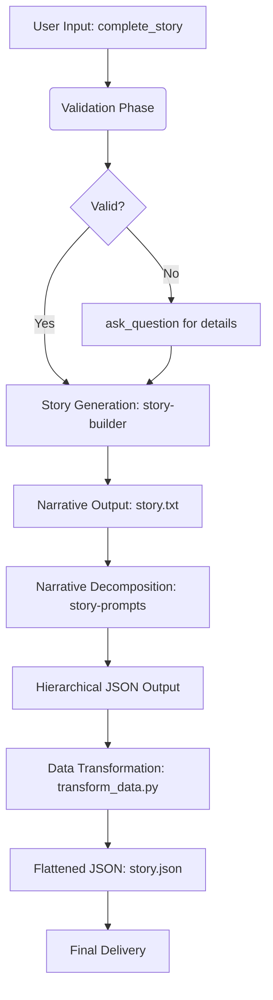

## 🎯 Overview

This skill performs **orchestration of content creation** on **initial story ideas/scenes** for **automated production-ready prompt generation**.

### Capabilities
- **Primary:** Integrates `story-builder` and `story-prompts` to transform raw ideas into structured data.
- **Secondary:** Handles narrative decomposition (Movie > Scene > Segment > Clip > Frame).
- **Output Format:** JSON (`story.json`) and Text (`story.txt`).

### Constraints (When NOT to use)
- If the user only wants a simple story summary without prompt generation.
- For tasks that do not require the specific `story-builder` or `story-prompts` pipeline.

---

## ⚙️ Operational Workflow

The agent MUST execute these steps **sequentially**. Provide a status update to the user after each phase.

### 1. Validation Phase
- **Check:** Verify `complete_story` input is present and contains sufficient narrative detail.
- **Action:** If missing or too brief, use `ask_question` to gather specifics (e.g., theme, tone, setting).

### 2. Story Generation Phase
- **Tool:** Call the `story-builder` skill using the user's provided input.
- **Goal:** Generate a formatted narrative file (`story.txt`) with cinematic cues and dialogue.
- **Path:** The output will be saved to the specified folder path (or current directory if not specified).

### 3. Narrative Decomposition Phase
- **Tool:** Call the `story-prompts` skill, providing the path of the newly created `story.txt` as input.
- **Goal:** Produce a nested JSON structure representing the hierarchy (Movie > Scene > Segment > Clip > Frame) with prompt data for each frame.

### 4. Data Transformation Phase
- **Script:** Execute `scripts/transform_data.py` via `run_commands`.
- **Command:** `python scripts/transform_data.py [input_json_path] [output_file_name]`
- **Goal:** Consolidate the nested JSON from `story-prompts` into a flattened structure suitable for production use.
- **Output Format:**
  ```json
  {
    "total_images": x,
    "images": [{
      "sno": "x",
      "scene": "xx",
      "segment": "xxx",
      "clip": "xx",
      "frame": "xx",
      "positive_prompt": "xxx",
      "negative_prompt": "xxx"
    }]
  }
  ```

### 5. Finalization Phase
- **Action:** Verify the output file (`story.json`) exists using `read_files`.
- **Output:** Confirm to the user that both the narrative (`story.txt`) and the production-ready prompts (`story.json`) have been generated successfully.

---

## 📥 Input Specification

| Field | Type | Requirement | Description | Example |
|-------|------|-------------|-------------|---------|
| complete_story | String | Required | The initial idea, scene, or narrative starting point provided by the user. | "A cyberpunk detective finds a glowing chip in a rainy alley." |

---

## 📤 Output Specification

### Final Delivery Format
Return the final result in this JSON structure:

```json
{
  "status": "success",
  "result": {
    "primary_output": "absolute/path/to/story.json",
    "supporting_assets": ["absolute/path/to/story.txt"]
  },
  "metadata": {
    "version": "1.0",
    "processing_time": "0ms"
  }
}
```

---

## 🛠️ Resource Map

| Resource | Path | Purpose |
|----------|------|---------|
| **Sub-Skill: Story Builder** | `.agents/skills/story-builder/` | Generates the initial narrative (`story.txt`) from user input. |
| **Sub-Skill: Story Prompts** | `.agents/skills/story-prompts/` | Decomposes the narrative into hierarchical frame prompts with prompt data. |
| **Transformation Script** | `scripts/transform_data.py` | Handles the flattening and consolidation of nested JSON into production-ready format. |
| **Output Template** | N/A (Inline in workflow) | Defines the final flattened JSON structure for image generation prompts. |

---

## 🔄 Integration Flow



---

## 💡 Usage Examples

### Example 1: Simple Idea to Full Pipeline
**User Input:** `"A detective finds a robot with human memories."`

**Expected Output Files:**
- `story.txt`: The full narrative script with cinematic cues.
- `story.json`: Flattened JSON with ~50-200 image prompts (depending on story length).

### Example 2: Scene-Specific Story
**User Input:** `"A cyberpunk detective finds a glowing chip in a rainy alley."`

**Expected Output Files:**
- `story.txt`: A short, focused narrative centered around the scene.
- `story.json`: Flattened JSON with ~10-30 image prompts for the specific scene.

---

## 📊 Expected Processing Time

| Story Length | Estimated Frames | Approximate Time |
|--------------|------------------|------------------|
| Short Scene (1 paragraph) | 10-30 frames | 5-10 seconds |
| Medium Story (2-3 pages) | 50-100 frames | 15-30 seconds |
| Long Story (5+ pages) | 100-200+ frames | 30-60 seconds |

---

## 🔍 Quality Checklist

Before confirming completion, verify:
- [ ] `story.txt` exists and contains formatted narrative with cinematic cues.
- [ ] `story.json` exists and is valid JSON (parseable).
- [ ] All images in `story.json` have non-empty `positive_prompt` fields.
- [ ] The flattened structure matches the expected schema (`sno`, `scene`, `segment`, etc.).
- [ ] Total image count is reasonable for the story length provided.

---

## 📝 Notes

1. **Skill Integrity:** The definitions of `story-builder` and `story-prompts` are strictly **READ-ONLY**. You must follow their internal instructions, rules, and formatting requirements exactly as written. Do not modify or simplify them during execution.
2. **Data Consistency:** Ensure that all narrative details (character descriptions, setting nuances, and specific plot points) remain consistent when passing data from the `story-builder` stage to the `story-prompts` stage.
3. **Default Paths:** If no folder path is specified, files will be saved in the current working directory (`output/`).
4. **Reusability:** The output `story.json` can be directly consumed by image generation pipelines (e.g., Midjourney, Stable Diffusion) for batch processing.


